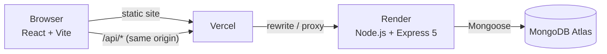

<div align="center">

# SportSync Academy Manager

**One secure platform to run a sports academy: players, coaches, scouts, attendance, matches and trial readiness.**


**[Live demo]([https://YOUR-PROJECT.vercel.app](https://sportsync-academy-manager.vercel.app/))** · [Architecture](#architecture) · [Security](#security-by-design) · [Run locally](#run-it-locally)

</div>

---

## The problem

Most small academies run on paper registers, WhatsApp groups and spreadsheets. Attendance goes unrecorded, nobody can say objectively which players are ready for a trial, and scouts either see nothing or see far too much private information.

## The solution

SportSync gives every person at the academy their own login and their own view of the same trusted data.

- **Admins** run the whole academy.
- **Coaches** manage only the sports they are assigned.
- **Scouts** see only players who have *earned* a spot, with no private notes.
- **Players** see only their own attendance, matches and performance.

Everything is enforced **on the server**, not just hidden in the interface.

> **Try it:** open the [live demo](https://sportsync-academy-manager.vercel.app/). The backend runs on a free plan, so the **first request after a quiet period can take up to a minute** to wake up.

| Role | How to sign in | Demo account |
|---|---|---|
| Admin | username |admin / adminpassword |
| Coach | email | test_coach@coach.com / cDlr3BiafWtLUQchXHYt |
| Scout | email | test_scout@scout.com / t18QXEsTlO20vR002Oy0 |
| Player | Player ID (e.g. `SA-0001`) | sa-0025 / kXUvd7Mn_P4jjtSYyZ6Q |

---


## What it does

### Admin
- **Players:** register players (IDs like `SA-0001` are generated automatically), edit profiles, record achievements and notes, deactivate players.
- **Coaches and Scouts:** create staff profiles with photos, experience (decimals allowed, e.g. 3.5 years), joining date and status. A login is created automatically.
- **Attendance:** start a daily session, check players in as Present, Late, Absent or Excused, then close it. Reopen a session to correct mistakes. A monthly report shows one row per player and one column per day.
- **Matches:** schedule fixtures, pick participants, record results and rate each player's performance (Excellent, Good, Average, Needs Improvement).
- **Games:** a sport-by-sport view of players and fixtures.
- **Trial Readiness:** an objective, explainable view of who is ready (details below).
- **Dashboard:** today's attendance, upcoming matches, recent activity and overdue-match alerts.

### Coach workspace
Overview of assigned sports, their players (and the only thing a coach may edit: a player's **position**), matches and attendance check-in, limited to their own sports.

### Scout workspace
A read-only, searchable list of **Ready** players with age, sports, position and achievements. Scouts never receive private notes, attendance records or non-ready players.

### Player portal
Overview and achievements, attendance with a monthly summary and history, and matches with their own performance.

---

## The idea that sets it apart: explainable trial readiness

Instead of a coach's gut feeling, readiness is calculated from real records:

| Criterion | Rule |
|---|---|
| Attendance | at least **75%** (Present + Late out of Present + Late + Absent; **Excused days are not counted against the player**) |
| Experience | at least **2 completed matches** |

A player is **Ready** only when every criterion is met. For anyone who is not, the system explains why in plain language, for example *"2 more matches needed"* or *"Attendance is 62.5%, below the required 75%"*, so the player knows exactly what to work on.

There is **one shared calculation** (`server/utils/readiness.js`). The Admin page, the Coach view and the Scout list all use it, so they can never disagree. Match performance ratings are shown for context but deliberately do not change readiness.

---

## Security by design

| Concern | How it is handled |
|---|---|
| Passwords | Hashed with bcrypt; never stored or logged in plain text |
| Sessions | JWT in an **HTTP-only cookie** (not readable by page scripts); `secure` in production |
| Authorization | Every rule is checked **on the backend**: role checks per route, plus data scoping (coach = own sports, scout = Ready players only, player = own record only) |
| Temporary passwords | Shown to the Admin **once**; the account is blocked from every route except "change password" until the user sets their own (12+ characters) |
| Deactivation | Inactive staff and players cannot log in; deactivating a profile disables the login |
| Privacy | Private notes and staff comments are never sent to Scouts or Players |
| Accountability | Important actions record the logged-in user |
| Errors and caching | API errors are always JSON; API responses are marked `no-store` |

---

## Architecture



The browser only ever talks to one address. Vercel serves the React app and forwards `/api/*` to the Express server, which keeps the login cookie first-party and avoids cross-site cookie and CORS problems.

### Tech stack

| Layer | Technology |
|---|---|
| Frontend | React 19, Vite 8, plain CSS (dark theme, responsive with a slide-out mobile menu) |
| Backend | Node.js 20+, Express 5 |
| Database | MongoDB Atlas with Mongoose |
| Auth | bcryptjs, JSON Web Tokens, cookie-parser |
| Hosting | Vercel (frontend), Render (API), MongoDB Atlas (data) |

### Project structure

```
├── src/                    React application
│   ├── App.jsx             Admin application shell and dashboard
│   ├── CoachWorkspace.jsx  Coach role
│   ├── ScoutWorkspace.jsx  Scout role
│   ├── PlayerWorkspace.jsx Player role
│   ├── TrialReadinessPage.jsx
│   ├── AttendancePage.jsx, MatchesPage.jsx, CoachesPage.jsx, ScoutsPage.jsx
│   └── useMobileNav.js, MobileShell.css   Mobile menu and page history
├── server/
│   ├── server.js           Express app, CORS, JSON error handling
│   ├── middleware/auth.js  Authentication and role authorization
│   ├── routes/             auth, players, coaches, scouts, attendance, matches, readiness
│   ├── models/             User, Player, Coach, Scout, Attendance, AttendanceSession, Match, Counter
│   ├── utils/readiness.js  The single definition of "Ready"
│   └── seed.js             Optional sample data (add / cleanly remove)
├── vercel.json             Proxies /api to the backend
└── DEPLOYMENT.md           Step-by-step deployment guide
```

### API at a glance

| Area | Base path | Who can use it |
|---|---|---|
| Authentication | `/api/auth` | everyone (login, logout, change password, session) |
| Players | `/api/players` | Admin full; Coach own sports; Scout Ready only; Player own record |
| Coaches / Scouts | `/api/coaches`, `/api/scouts` | Admin only |
| Attendance | `/api/attendance` | Admin and Coach; Player reads own history |
| Matches | `/api/matches` | Admin; Coach own sports; Scout Ready players; Player own matches |
| Readiness | `/api/readiness` | Admin and Coach |

---

## Run it locally

Requirements: Node.js 20+ and a free MongoDB Atlas cluster.

```bash
git clone https://github.com/YOUR-USERNAME/YOUR-REPO.git
cd YOUR-REPO
npm install
cp .env.example .env        # then fill in the values
npm run server              # API on http://localhost:5000
npm run dev                 # app on http://localhost:5173  (second terminal)
```

1. Create the first Admin once: `POST /api/auth/setup-admin` with a username, password and your `ADMIN_SETUP_KEY`.
2. Optional: `node server/seed.js` adds sample players, matches and attendance so every screen has data. `node server/seed.js --remove` deletes only that sample data.

Deploying your own copy? Follow [DEPLOYMENT.md](DEPLOYMENT.md).

---

## Honest status

**Built and working:** authentication, forced first-login password change, admin/coach/scout/player roles and workspaces, attendance, matches, trial readiness, responsive layout with a mobile menu, and production deployment.

**Testing:** verified by hand, role by role (including attempts to reach other roles' data). There is **no automated test suite yet**; adding one is the top engineering priority.

**Known limitations**
- No self-service password reset yet (an Admin must help a user who loses a temporary password).
- No login rate limiting or account lockout yet.
- Free-tier hosting: the API sleeps when idle, so the first load can be slow.

## Roadmap

1. Admin password reset and account management
2. Events and scheduling: training schedule, trial dates, tournaments, announcements
3. Reports and analytics with filtering and export
4. Settings and administration: academy info, sports configuration
5. Automated tests, login rate limiting, session review

---

<div align="center">

**Built by saksham and piyush** · [GitHub](https://github.com/wandofwisdon3399) · wandofwisdon3399@gmail.com

</div>
